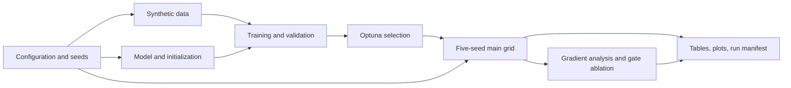

# Architecture proposal

Status: **approved for ticket planning; no implementation has begun**. Source baseline: [notebook audit](notebook_audit.md). The notebook remains the reference artifact and is not renamed, overwritten, or edited.

## Design goal

Make the existing experiment runnable from a clean Python environment, test its scientific behavior, and keep research code small enough to inspect. Separate data generation, model equations, training, orchestration, and reporting. Preserve the current experimental semantics first; address documented bugs in separate follow-up tasks.

## Proposed layout

```text
Notebooks/GradientVanishingAnalysis.ipynb   # immutable baseline
src/gradient_vanishing/
    config.py          # load and validate experiment configuration
    data.py            # synthetic task, fixed validation/test sets
    models.py          # three recurrent models, initialization, model factory
    training.py        # train one seeded run; evaluate final model
    experiments.py     # tuning, run grid, gradient analysis, ablation, sweep
    reporting.py       # tables and plots from saved results
    cli.py             # thin command entry point for reproducible runs
configs/default.json   # versioned baseline experiment configuration
tests/                 # semantic and regression tests
docs/                  # audit, spec, run instructions, bug follow-ups
pyproject.toml         # package/dependency metadata and test configuration
```

The entry point can expose `main`, `gradients`, `ablation`, `sweep`, and `report` commands. Each experiment command receives a validated JSON configuration and output directory and writes a run manifest plus machine-readable results and figures. `report` regenerates tables and figures from saved results. The training-gradient heatmap depends on gradient histories from `main`; initial-gradient analysis, ablation, and sweep can run on their own. JSON uses the standard library and avoids another configuration dependency. Avoid a plugin framework, database, experiment service, or separate classes for every plot.

## Module contracts

| Owner | Inputs | Outputs and invariants |
| --- | --- | --- |
| `config.py` | JSON configuration and limited CLI overrides | One validated experiment configuration; defaults equal baseline values, including gate mode `one` |
| `data.py` | `batch_size`, `T`, generator/device | `(T,B,1)` input and `(B,1)` target; only step zero nonzero; separate fixed validation/test generators and per-`T` cache |
| `models.py` | `(T,B,1)` tensor and initialization settings | `(B,1)` prediction; same manual equations, initial zero states, tracked hidden states, and initialization order; custom GRU sign convention retained |
| `training.py` | Model name, config, `T`, seed, update count | Final model and history; fresh batch per update, Adam/MSE/clip norm 5, fixed validation checks; evaluation state behavior initially matches baseline |
| `experiments.py` | Config and selected experiment | Same Optuna search, seeds, run grid, final test metric, gradient calculations, and ablation conditions |
| `reporting.py` | Serializable experiment results | Existing tables/plots, with documented differences between displayed and computed quantities |

Prefer plain functions and small typed data records over a hierarchy of runner objects. Keep the recurrent classes separate inside one module because their formulas are the central research object. Pass device and configuration explicitly at module interfaces. Keep the baseline's global training RNG stream and separate fixed-set generators during the preservation phase; replacing them with new generators would change sampled batches despite identical seed values. Construct and initialize models on CPU before moving them to the device.

## Execution and data flow



Optuna invokes the same single-run training function as the main grid with a shorter update budget. The test set is accessed only after a main or ablation run finishes, never by the Optuna objective. Reporting consumes results rather than triggering training. A lightweight result schema should carry raw per-seed metrics, effective config, selected trial parameters, histories, and completion status; human-readable tables can be regenerated from it. The run manifest should also record source revision, notebook hash, dependency versions, Python/Torch/CUDA details, device, deterministic settings, seeds, and command.

## Scientific compatibility boundary

The first extraction should reproduce formulas, shapes, target distribution, seeds, trial search, training budgets, update order, final-checkpoint selection, measured hidden gradients, sample-standard-deviation convention, and the unusual GRU update equation. It should **document** current defects without fixing them in the same change. In particular, changing `W_z.bias` to `W_r.bias`, swapping the GRU blending terms, selecting the best validation checkpoint, or redefining an “epoch” would create a new experiment.

New run manifests and saved result files are permitted as observational outputs. A committed resolved dependency manifest defines one tested reference environment; a CUDA variant can be documented separately. Set `CUBLAS_WORKSPACE_CONFIG` before importing Torch when CUDA determinism is requested, and surface unsupported deterministic operations. Exact bitwise results across different devices/library versions are not a compatibility target; deterministic small-case calculations on a pinned environment and the saved baseline's qualitative conclusions are. The numerical tolerances and baseline fixtures must be established before module extraction.

## Decision points for plan approval

1. Approve this small package layout and CLI plus artifact approach.
2. Approve the baseline compatibility boundary and separate bug-fix tasks.
3. Confirm a supported Python/Torch environment and practical hardware budget for a full grid. The spec allows a fast verification tier before that expensive run.
